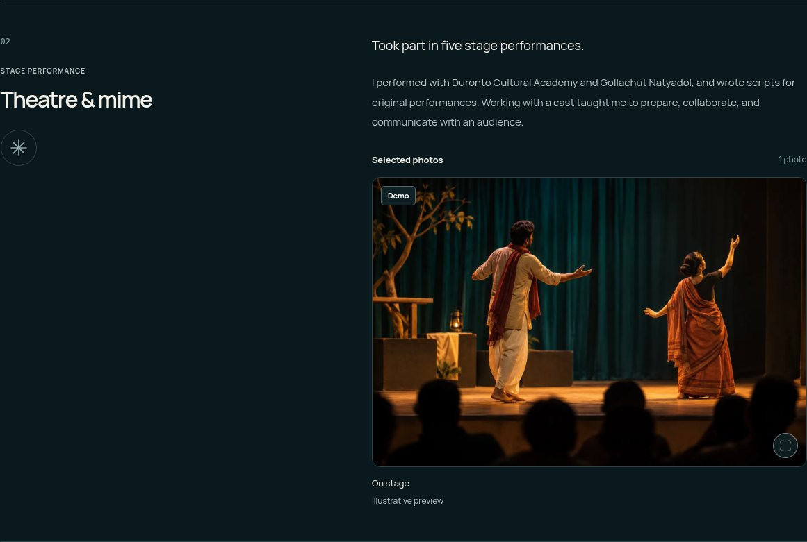
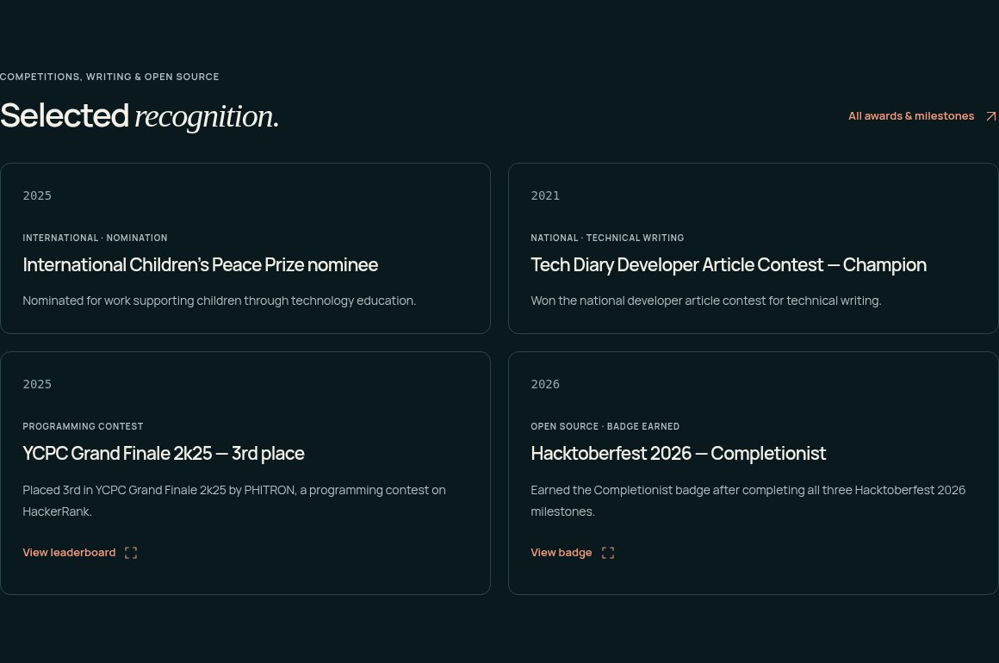
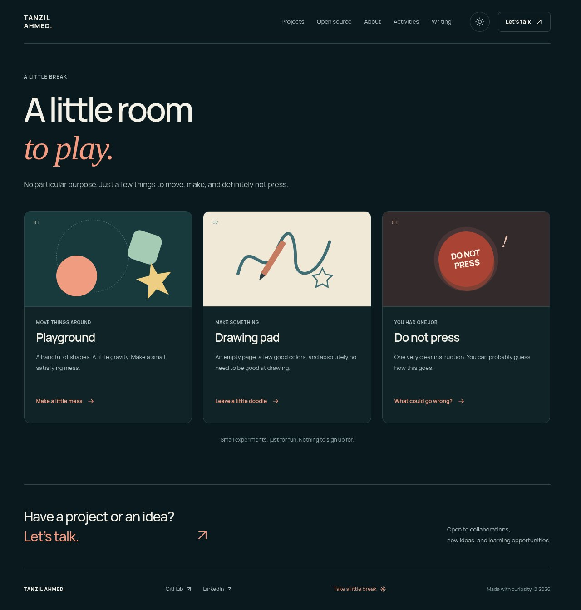
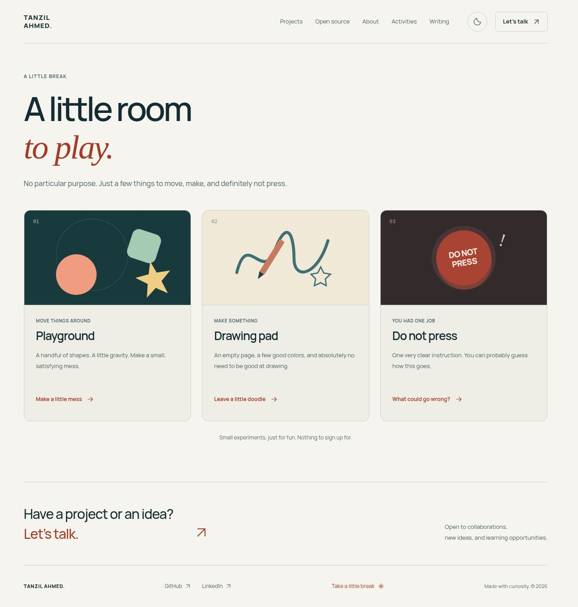
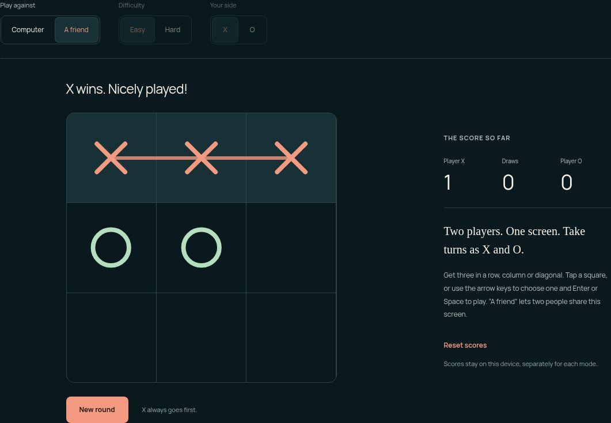
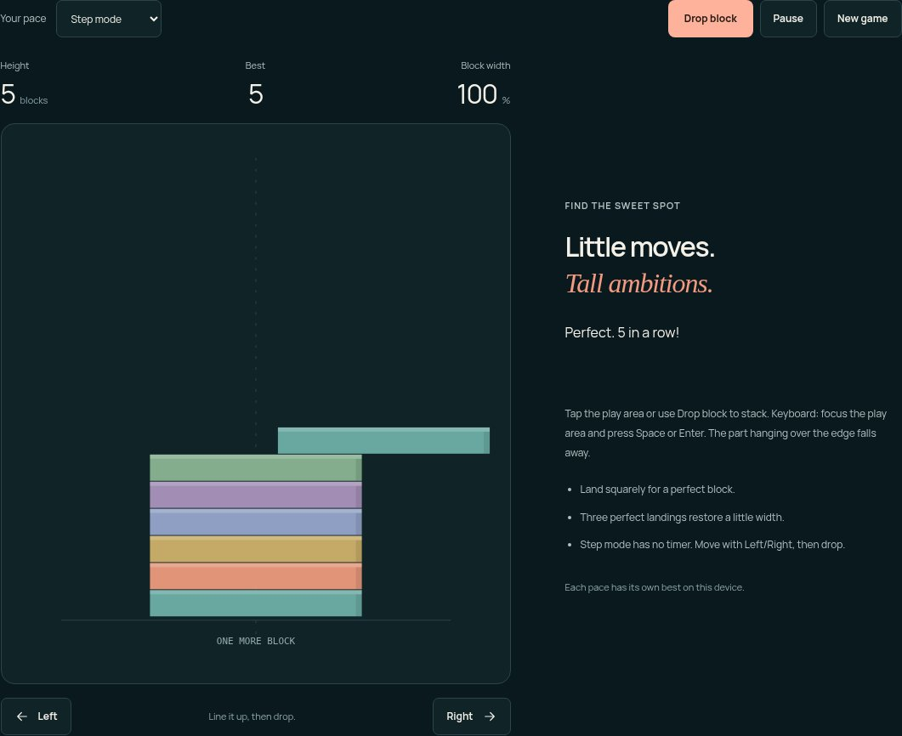

# Tanzil Ahmed — Offscript

Tanzil Ahmed’s portfolio: projects, open-source work, experience, recognition, community activities and writing. Built with **Astro + TypeScript**, fully static and database-free, with dark/light themes and local fonts/images.

**Live:** https://tanzilahmed.tech/ · **Publishing branch:** `master` · **Deployment:** GitHub Pages Actions

| Dark | Light |
| --- | --- |
|  |  |

## Content update / সহজে edit করুন

GitHub থেকে সরাসরি `master`-এ edit করতে পারেন। প্রতিটি item-এর একটি source file; সেখান থেকে সংশ্লিষ্ট Home/list/detail views তৈরি হয়। Layout edit করতে হয় না।

**[সহজ বাংলা content update manual →](docs/CONTENT-GUIDE.md)**

| Update | Source |
| --- | --- |
| Name, headline, intro, About bio, email, GitHub/LinkedIn, photo caption | [`src/data/profile.json`](src/data/profile.json) |
| Projects and case studies | [`src/content/projects/`](src/content/projects/) |
| Open-source PRs and published website contributions | [`src/content/contributions/`](src/content/contributions/) |
| Original posts/essays and external article links | [`src/content/notes/`](src/content/notes/) |
| Debate, theatre, teaching and volunteering | [`src/content/activities/`](src/content/activities/) |
| Work experience | [`src/content/experience/`](src/content/experience/) |
| Awards, recognition and milestones | [`src/content/milestones/`](src/content/milestones/) |
| Portrait | `src/assets/tanzil.jpg` |
| Badge artwork and recognition proof images | `src/assets/recognition/`, referenced by the milestone’s `image` field |
| Article/project images | `public/media/` |
| Activity photos | `public/media/activities/`, referenced by the relevant activity's `gallery` |
| Play/game headlines, cards, colors, prompts, game reactions and the corner accessible label | [`src/data/play.json`](src/data/play.json) |

### Add an article

Copy [`templates/post.md.example`](templates/post.md.example) to `src/content/notes/my-article.md`. Fill in the title, summary, publication `date` (`YYYY-MM-DD`) and Markdown body. Set `draft: false`, commit to `master`, and wait for the successful Actions deployment. The article appears at `/notes/my-article/`; Writing, RSS and sitemap update automatically.

For an external publication, use [`templates/note.md.example`](templates/note.md.example): set `kind: "external"`, the real publication date, platform and URL. The Writing filters distinguish **On this site** from **Elsewhere**. Native posts support optional written/updated dates; “Grandma’s Xbox” preserves its 2024 admission context separately from its site publication date.

Draft content is excluded from generated pages, RSS and sitemap. A public Git repository still exposes committed draft source, so keep private drafts outside the repository.

### Choose Home highlights

- Projects: first four published `featured: true` entries, sorted by `order`. Current selection: Tuktak, ScopeProof, EngJatra and Choreseed. Cargotab/Tanzilbot stay under Earlier work.
- Contributions: up to three featured entries. A `spotlight: true` entry also receives a detailed Open source feature; Tabbycat’s published website work links to its source and upstream integration.
- Recognition: up to four featured milestones in a two-column desktop grid. All awards and work experience appear on About; Hacktoberfest milestones also appear under Open source. Optional local badge artwork and proof-image links come from the same milestone file. Current highlights include YCPC Grand Finale 2k25 (3rd place) and Hacktoberfest 2026 Completionist. The Completionist entry uses the same text-only layout as other recognition, with a single **View badge** proof link.
- Activities: featured entries appear on Home; all published activities appear under Activities. Edit one activity’s summary once to update both views.
- Activity photos: add `gallery` entries to the same activity file. Set `homePreview: true` to choose its first photo for the Home preview. Photos follow each activity’s description directly, with captions; optional demo entries show a small Demo badge. Captions support event/year/role; the full-image viewer supports keyboard navigation and works with direct image links without JavaScript. The current gallery uses owner-supplied event photographs, optimized as local WebP images. [Update photos using the guide](docs/CONTENT-GUIDE.md#activity-photos--আসল-ছবি-বসানো).
- Writing: the first featured entry, or the latest entry when none is featured. About also shows the first featured personal essay. Writing itself sorts by publication date, then `order`.

## UI and project structure

Offscript uses a restrained editorial layout: consistent project cards, readable body text, serif accents, quiet surfaces, and one coral/terracotta accent across dark and light themes. Buttons, filters, navigation and focus states share the same rules. Activities are available in desktop, mobile and no-JavaScript navigation.

The first Home visit in a tab has a brief wordmark/portrait entrance and a single typing pass for the two profile headlines. Brief desktop heading fades, project/button feedback, and smooth gallery changes add motion without blocking navigation. Reduced-motion settings show the complete headline immediately. Native articles have a thin reading-progress line, and activity photos use equal 3:2 frames in a consistent two-column desktop grid and a single column on mobile. Touch scrolling keeps sections static; large project/photo grids never animate into view. Everything remains static and database-free; no animation dependency was added.





### A little room to play

The footer's unboxed **Take a little break** link opens `/play/`. Five illustrated choices lead to their own static pages, with the two games highlighted first:

| Activity | What you can do |
| --- | --- |
| [Tic-tac-toe](https://tanzilahmed.tech/play/tic-tac-toe/) | Computer Easy/Hard or two players on one screen; choose X/O, use touch or keyboard, replay and keep device-local scores. Hard plays perfectly; computer scores follow you when changing sides. |
| [Stack Tower](https://tanzilahmed.tech/play/stack-tower/) | Tap/click/Space to stack, trim overhangs and chase perfect landings. Chill/Classic offer timed play; Step mode uses Left/Right with no timer. Each pace has its own device-local best. |
| [Playground](https://tanzilahmed.tech/play/playground/) | Drag/throw shapes, keyboard movement, gravity, pause, add/reset and Shuffle. |
| [Drawing pad](https://tanzilahmed.tech/play/drawing-pad/) | Colors/brush/eraser/mirror, Undo/Redo, reversible clear, prompts, keyboard pen, star stamp and an opaque PNG download. |
| [Do not press](https://tanzilahmed.tech/play/do-not-press/) | A stable button, unexpected reactions, reset and optional sound. |

Each page has native back/other-game links. Old `/play/#draw` and related bookmarks still work; only the selected engine loads. Scores stay in the browser, with a visit-only fallback when device storage is unavailable. Drawing is recovered from the current tab's session on normal navigation/reload; download PNG for a lasting copy. Nothing is uploaded. Physics sleeps when settled; timed tower play pauses offscreen/backgrounded and waits for explicit Resume. Reduced motion defaults the tower to untimed Step mode.

The fixed **✦** button sends silent ducks, bubbles or stars across the visible screen for about **5.5 seconds**, with no popup text or tooltip. It never moves the page or intercepts clicks. Effects load only on first use, stay bounded, replace previous effects on repeat clicks and clean up automatically or with Escape/background/navigation. Reduced motion uses static decorations. The control hides during photo viewing, open mobile navigation and focused game interaction. The footer pairs open contact/Play links above a compact identity/social row. Desktop spacing is reduced and copyright sits at the center, independently of the wordmark/social widths; the mobile identity stack stays unchanged. No backend or packages were added.

| Play — dark | Play — light |
| --- | --- |
|  |  |

| Tic-tac-toe | Stack Tower |
| --- | --- |
|  |  |

See the [drawing preview](docs/images/play-drawing.jpg), [footer preview](docs/images/footer-dark.jpg) and [implementation plan](docs/PLAY-PLAN.md).

| Responsibility | Location |
| --- | --- |
| Color/spacing tokens, typography, components and responsive layouts | `src/styles/global.css` |
| Shared navigation, theme initialization, footer and metadata | `src/layouts/Layout.astro` |
| Shared project, recognition, writing and filter components | `src/components/` |
| Page composition and generated article/project routes | `src/pages/` |
| Content field validation and draft/order rules | `src/content.config.ts`, `src/lib/` |
| Theme/menu/filter/copy/gallery interactions | `src/scripts/site.ts` |
| Headline typing, lightweight heading fades and article reading progress | `src/scripts/motion.ts` |
| Play landing/game routes and lazy activity engines | `src/scripts/play/`, `src/pages/play/`, `src/components/PlayWorkspace.astro`, `src/styles/play.css` |
| Native game UI and independently testable rules | `src/components/games/`, `src/scripts/play/games/` |
| On-page corner surprise, loaded on demand | `src/components/PocketSurprise.astro`, `src/scripts/pocket.ts`, `src/scripts/fun/` |
| Reusable content examples | `templates/` |
| Production-output, content-authoring and browser checks | `tests/`, `scripts/check-authoring.mjs` |

Read [the UI guide](docs/UI-GUIDE.md) before changing shared components. Keep the implementation, README, content guide and relevant release/verification notes in sync; repository working instructions are in [AGENTS.md](AGENTS.md).

## Local development and checks

Use Node **24.19.0** (`.nvmrc`). Run `npm ci`, then `npm run dev`; the CLI prints the address. `npm run build` writes the static site to `dist/`, and `npm run preview` serves that output.

```sh
npm ci
npm run check
npm run build
npm test
npm run test:authoring
npm run test:browser
```

Run authoring tests before browser tests, not concurrently: authoring checks build temporary content, remove it, then rebuild the original site. Browser checks use `/usr/bin/chromium` when available; otherwise run `npx playwright install chromium` or set `PLAYWRIGHT_CHROMIUM_EXECUTABLE`. The browser suite starts a production preview on port 4321 when needed. See [verification notes](docs/VERIFICATION.md) for recorded results and limits.

## Publishing and domain

Pushes to `master` run `.github/workflows/pages.yml`: install, type checks, static build, authoring/output/browser checks, then publish `dist/` through GitHub Pages. PRs run checks without deploying. The workflow is **Check and deploy portfolio** under Actions. Pages must use **GitHub Actions** as its source; the current site is already configured.

Canonical origin: **https://tanzilahmed.tech**. See [custom-domain/DNS maintenance](docs/CUSTOM-DOMAIN.md). If the domain changes, update `astro.config.mjs`, `public/robots.txt` and `public/CNAME`; generated-link checks verify they agree. RSS is at `/rss.xml`, sitemap at `/sitemap.xml`.

The public contact email is configured once in `profile.json`; Contact provides email/copy actions, GitHub and LinkedIn. No phone number, source application PDF, private address or application IDs belong in the public build. Publish only `dist/`. The personal essay was supplied for publication by its author. See [release notes](docs/RELEASE-NOTES.md) and [credits](docs/CREDITS.md).
